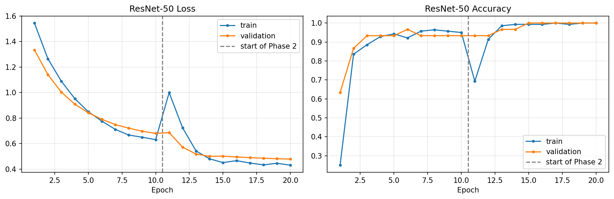
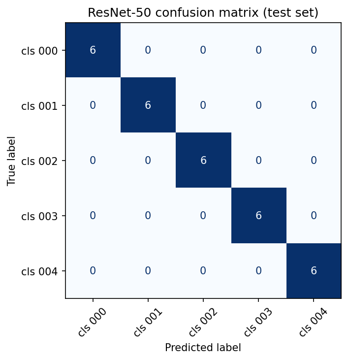
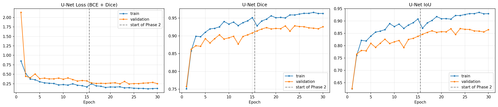
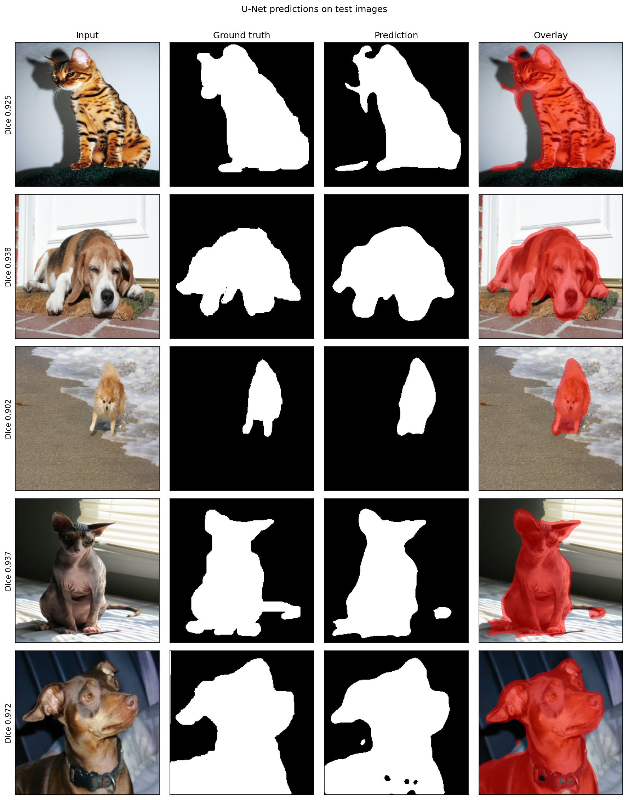

# Fine-tuning ResNet-50 and U-Net on small image datasets

**Name:** Mohid Faisal  |  **Roll No:** BSCS23092

Transfer learning with two pretrained models on small datasets (about 100-200 images each):
- **ResNet-50** for flower classification (5 classes x 40 images)
- **U-Net with a ResNet-50 encoder** for pet segmentation (150 image/mask pairs)

## Datasets (not included in this repository)
- Oxford Flowers-102: https://www.robots.ox.ac.uk/~vgg/data/flowers/102/ (5-class subset, 40 images each)
- Oxford-IIIT Pet: https://www.robots.ox.ac.uk/~vgg/data/pets/ (150 image/mask pairs, trimap converted to binary pet/background)

## Method
- 70/15/15 train/validation/test split (stratified for flowers). The test set was used only once at the end.
- **ResNet-50:** Phase 1 trains the new classifier only (frozen backbone); Phase 2 also fine-tunes `layer4` with a 10x smaller learning rate and a cosine schedule. Label smoothing 0.1.
- **U-Net:** Phase 1 trains the decoder with a frozen encoder; Phase 2 also fine-tunes `layer3` and `layer4` using discriminative learning rates. Loss = BCE + Dice.
- Augmentation is applied to training images only. For segmentation, the same spatial transform is applied to image and mask.

## Results (test set)
| Model | Metric | Result |
| --- | --- | ---: |
| ResNet-50 | Accuracy / macro precision / recall / F1 | 1.000 / 1.000 / 1.000 / 1.000 |
| U-Net | Dice / IoU / pixel accuracy | 0.926 / 0.866 / 0.948 |

ResNet-50 validation accuracy was 1.000. U-Net validation Dice was 0.928 (test 0.926), so the models generalise to unseen data. The test sets are small (30 flower images and 23 pet images), so these scores have some uncertainty.

## Files
- `notebook/assignment_resnet_unet.ipynb`: full notebook with outputs
- `results/`: figures and CSV tables

## Trained weights
Not stored on GitHub because of file size

## How to run
Open the notebook in Google Colab with a T4 GPU and run it top to bottom. It downloads the datasets from the Oxford URLs.